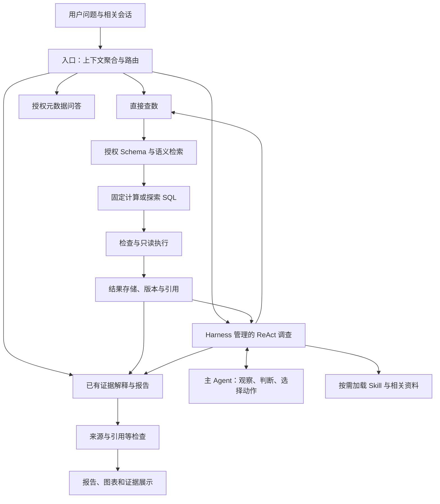

# InsightPilot · 电商经营分析 Agent

[在线试用](https://insightpilot-demo.onrender.com) · 支持游客体验和管理员登录。免费服务首次唤醒可能需要等待。

**从查数的“是多少”，走向分析的“为什么”。**

InsightPilot 将单次取数延伸为围绕业务问题的连续分析：根据结果动态下钻，用证据核实解释，再把发现整理成可追溯的报告。从获取数字，到理解变化，帮助业务人员找到下一步值得采取的行动。

**业务问题驱动调查，数据证据推动判断，Harness 管理执行。** 项目以跨境电商为切入场景，路由、按需 Skill、任务状态和上下文管理等设计经验，也可为企业经营分析、财务分析等领域提供借鉴。

## 为什么做这个项目

在电商实习中，我接触到公司已经落地的 Text2SQL 工具。它降低了发起查询的门槛，但实际使用中仍然存在查数不准、单次查询难以承接后续分析的问题。

**更大的工作量往往发生在拿到数字之后。**

下面是根据这些痛点构造的典型工作场景：

> 月度复盘前，运营发现店铺 GMV 下滑，但看板上的整体流量没有明显变化。
>
> 第一轮查数确认了销售额下降，却没有回答该采取什么行动。运营接着需要检查订单量和转化，再拆到渠道、品类和商品；如果发现某个商品变体下降，还要判断是整体需求变弱、库存影响，还是购买转向了其他变体。
>
> 每查出一组结果，都可能出现一个新问题。运营需要不断调整查询、确认指标口径、记录已经排除的解释，再把多个结果拼成复盘报告。

这段流程暴露了三个产品问题：

| 工作中的阻力 | 产品需要提供的帮助 |
|---|---|
| 用户知道业务问题，却不熟悉数据表、关联关系和统计口径 | 将业务表达转成带有明确范围和定义的查询 |
| 一次取数只解决一个局部问题，下一步依赖刚查到的结果 | 根据证据动态决定继续查什么、从哪个维度下钻 |
| 查询结果分散，判断会不断变化，复盘需要重新整理 | 保存结果与判断的关系，把发现、反证和未决项组织成报告 |

因此，项目把目标定为：**让运营围绕一个经营问题持续分析，把更多精力用于判断和行动。** 首批用户是跨境电商运营和业务人员，分析产物服务于异常排查和经营复盘。

## 用户如何使用

| 用户提出的问题 | 系统如何响应 | 设计价值 |
|---|---|---|
| “七月 GMV 是多少？” | 直接查询适用指标 | 简单问题使用简短路径 |
| “七月 GMV 为什么下降？” | 核实变化，再按证据逐步下钻 | 支持分析路径不确定的任务 |
| “那按品类呢？” | 结合前文承接指标、期间和范围 | 减少重复描述条件 |
| “把刚才的结果整理成报告” | 读取保存的实际证据组织报告 | 让取数成果可以继续使用 |
| “现在有几张表？” | 读取授权目录，由 Agent 按问题回答 | 帮助用户了解可用数据 |

报告围绕四件事展开：**发生了什么、证据支持什么解释、还存在哪些不确定性、下一步值得做什么。** 用户可以继续追问、补充背景或核对来源。

## 核心设计与亮点

项目围绕四个连续环节设计：**理解业务问题 → 依据证据调查 → 可靠地取数 → 让用户看懂并继续使用结果。** 路由、检索、规划、上下文和工作台共同服务于这个过程。

| 环节 | 关键设计 | 对用户的价值 |
|---|---|---|
| 理解问题 | 意图路由、上下文聚合、必要澄清 | 能承接追问，减少重复说明和范围误解 |
| 推进调查 | ReAct、隐式规划、任务看板、按需 Skill | 根据结果选择下一步，持续围绕原问题 |
| 获取数据 | Schema RAG、混合召回与 Rerank、固定计算与探索 SQL | 连接业务词汇与真实数据结构，复用明确口径 |
| 形成交付 | 证据引用、正常项与反证展示、报告续作、前端工作台 | 看懂结论依据，了解查过什么，继续核查和追问 |

### 1. 意图路由：理解问题，选择处理方式

入口结合当前问题和近期上下文，判断是直接查数、继续调查、解释已有结果，还是生成报告。例如“那按品类呢”承接前面的指标与期间，“整理成报告”则优先使用已有证据。

**设计价值：** 简单问题直接处理，复杂问题进入调查，追问承接已有工作，减少用户重复说明。

### 2. ReAct、隐式规划与任务看板：路径动态调整，进度始终清楚

**面对的问题：** 经营异常往往需要查过数据才知道应当深入哪里。项目早期尝试 Plan-and-Solve，但提前制定的具体计划容易过早锁定解释，也容易把“步骤执行完”当成“问题已回答”。

因此，复杂调查调整为 ReAct，将规划融入每轮决策：

> 查看目标与当前证据 → 找出关键缺口 → 选择下一步动作 → 执行取证 → 更新任务看板 → 决定继续、转向、询问或交付。

这里的**隐式规划**指 Agent 根据已有结果逐步决定行动，不必在开始时固定全部步骤。例如，发现下降集中于一个品类，就进一步查该品类；如果多个品类普遍下降，则检查共同因素。原始目标保持明确，调查路径随证据调整。

为了让灵活探索保持方向，系统维护一份持续更新的**任务看板**。它以结构化任务状态为底层，前端通过阶段记录、发现和问题展示进展：

| 看板内容 | 回答的问题 |
|---|---|
| 目标与范围 | 当前在回答谁的问题，期间和口径是什么？ |
| 已做检查与结果 | 查过什么，哪些正常、异常或没有取得结果？ |
| 当前事实与候选解释 | 已经知道什么，还在验证什么？ |
| 支持与反证 | 哪些证据支持某个解释，哪些削弱它？ |
| 未解决问题与本轮安排 | 还缺什么，接下来准备如何推进？ |

Agent 每轮结合看板选择动作，再把新结果和判断写回状态。同一判断使用稳定 ID 更新；撤回或被替代的判断进入历史，避免新旧解释同时被当作有效结论。

**设计价值：** 隐式规划让系统能根据证据转向，任务看板让调查过程可追踪、可承接。二者配合，既减少固定计划对探索的束缚，也帮助控制发散、重复查询和目标偏移。

### 3. 按需 Skill：沉淀三个场景的方法，并为新业务留出扩展空间

**面对的问题：** Agent 需要业务方法指导，但不同问题不需要同时读取全部规则。把所有方法写进一个长提示词，既增加输入，也让后续维护困难。

目前登记了三个业务场景的 Skill：

| 业务 Skill | 适用场景示例 | 提供的方法 |
|---|---|---|
| 经营诊断 `business_diagnosis` | 指标下滑、异常波动、经营变化解释 | 核实变化、检查相关指标、选择下钻方向，并记录支持与反证 |
| 目标分析 `goal_analysis` | 目标完成度、实际与目标差距 | 对齐目标与实际口径，计算进度和缺口；参数明确时分析达成所需条件 |
| 库存风险检查 `inventory_risk_check` | 可售库存、历史缺货、供给风险 | 核实库存与采购事实，结合明确需求和到货假设进行条件式风险检查 |

**Skill 如何按需调用：**

1. 主 Agent 先看到可用业务 Skill 的名称与简介，判断当前任务需要哪类方法。
2. 需要时提出 `load_skill` 动作，由运行层检查是否已注册、是否在本次任务启用范围内，再读取对应正文。
3. 正文返回后进入任务上下文，Agent 据此选择指标与取证方向；已经加载的方法复用，避免重复读取。
4. 调查出现新的问题方向时，可以补充加载适用 Skill。简单取数不要求先把业务 Skill 全部读完。

Skill 的选择融入主 Agent 的调查决策，无需单独增加一个“选择 Skill 的 Agent”。运行层记录加载内容和版本，便于追溯某次分析使用了什么方法。SQL 查询和结果问答另有基础能力，不计入上述三个业务场景。

**可扩展性：** 新场景可以增加对应方法文档和注册配置，说明适用问题、必要资料、分析方法及证据边界，再接入匹配的数据语义与验收题。比如企业经营分析中的部门业绩拆解、财务分析中的预算差异分析，都可以借鉴这一组织方式；方法扩展与底层工具权限、计算能力分别管理。

**设计价值：** 将业务经验变成可维护、可组合的方法，按需提供给 Agent。跨境电商是项目切入场景，Skill、任务状态、检索和证据管理的设计经验也可用于企业经营分析、财务分析等领域，迁移时适配各自的业务口径与数据要求。

### 4. 按角色与阶段组装上下文，兼顾输入效率与证据完整性

**面对的问题：** 实际运行中，部分任务累计输入达到输出的二十多倍。检查模型请求后，发现任务信息、Schema、指标定义和历史结果存在重复，因此把上下文分配纳入代码管理。

| 角色 | 主要输入 | 服务于什么决策 |
|---|---|---|
| 路由 Agent | 当前问题、近期轻量上下文、任务与结果目录 | 当前请求承接什么，应走哪条路径 |
| 主 Agent | 目标、有效判断、检查目录、结果摘要与必要数据 | 下一步查什么，是否需要转向或收尾 |
| 查数模块 | 当前查询的口径、相关字段、依赖与诊断 | 如何完成这次取数或技术修复 |
| 报告 Agent | 实际相关证据、当前判断、正常项、反证与限制 | 哪些发现可以呈现，数字和解释如何组织 |

提示词、任务状态、Skill 和结果分开管理，由代码根据角色与阶段选择、去重和组装。共享指标定义通过编号关联；SQL 修复重点提供失败项，已完成的同批查询不反复完整进入修复输入。

完整结果保存在外部，必要时按引用读取。主 Agent 的精简视图仍保留范围、单位、完整性和待核对项；报告模块可以获得实际相关数据，而不是只凭几句摘要组织数字。

**已有量化证据：** 对两份历史任务的同一末态离线组装输入，主 Agent 输入字符数分别减少 **46.8% 和 53.0%**，保留了结果与检查目录。这是字符数变化，不是实际 token 费用降幅。

**设计价值：** 降低重复资料占用，让模型关注当前任务；完整证据与精简视图分离，也使成本优化不必以丢弃结果、正常项或反证为代价。

### 5. Schema RAG、混合召回与 Rerank，把业务问题连接到真实数据

**面对的问题：** 运营使用业务语言，数据库保存的是表和字段。相似词可能对应不同指标，仅靠字段名匹配容易遗漏；直接传入全部 Schema 又会增加干扰和输入量。

字段索引组织字段含义、业务别名、所属表、样例及关联信息。检索流程分为四步：

| 步骤 | 工作方式 | 解决的问题 |
|---|---|---|
| BM25 关键词召回 | 匹配字段名、业务术语等明确线索 | 保留精确词汇命中的候选 |
| Embedding 向量召回 | 根据自然语言语义寻找相关字段 | 补充不同表达之间的关联 |
| RRF 排名融合 | 合并两路召回的排名 | 综合字面与语义匹配线索 |
| Rerank 重排 | 结合原问题重新评估候选，再按阈值和数量筛选 | 从召回候选中选择更相关的资料 |

例如用户说“销量”，系统需要结合业务定义判断关注的是订单数还是商品件数；检索负责找到候选字段与语义资料，后续再通过上下文、口径和必要澄清完成判断。召回与重排不是业务含义的最终裁决。

检索候选受访问权限约束，选出的字段与相关口径共同进入查询资料组装。HomeNova 数据适配复用这一检索流程，业务数据源与通用检索机制分开组织。

**设计价值：** 在业务表达与实际数据结构之间提供可维护的连接方式，兼顾候选覆盖和输入相关性；检索日志也为定位“没找到字段”与“找错字段”提供依据。

### 6. 固定计算与探索 SQL 配合，复用标准口径并保留取证灵活性

**面对的问题：** 同一个标准指标不应每次重新发明计算方法，但新明细、新维度和非常见问题又无法全部预先模板化。

查数模块采用两种计算路径：

- **已覆盖的登记指标：** 根据指标定义、数据源、语义版本、期间、维度和筛选检查适用性，由程序构造确定的查询或计算。
- **新的探索需求：** 根据相关资料由模型生成 SQL，并进入查询检查与只读执行流程。

当前固定计算覆盖有限范围的支付商品 GMV、订单数、件数及派生指标，也包含会话和库存时长相关路径。比如库存时长需要处理期初状态、分区以及时间区间与月份的交集，适合沉淀为受控计算方法。

两种路径共用权限、结果记录与预算。未覆盖的普通请求可以走探索 SQL；统计集合冲突或受控计算缺少条件时先处理问题，不为命中模板而静默改变用户范围。

**设计价值：** 将稳定规则沉淀下来，减少重复生成带来的口径波动；同时保留 Agent 对新问题提出和实现取证需求的能力。

### 7. 业务澄清与技术修复分工，让用户参与真正需要判断的环节

**面对的问题：** 系统遇到困难时，不能把字段选择和 SQL 调试交给业务用户；但影响答案的业务含义，也不应由模型擅自猜测。

| 发生的情况 | 处理方式 |
|---|---|
| 必要期间、对象或指标定义不明确 | 提出具体问题，确认后再启动相关调查 |
| 缺少用户可能知道的补充业务背景 | 调查中按需提问，可选问题允许跳过 |
| 缺字段、技术映射或检索资料 | 系统补充相关上下文 |
| SQL 生成或执行出错 | 返回真实诊断，在原预算内定向修复 |

澄清卡片提供问题、简短原因和回答操作。跳过不等于确认某个默认答案，已回答或跳过的问题没有实质变化时不反复询问。用户补充的业务背景保留来源，也不会自动升级为已证实因果。

**设计价值：** 把业务决定交给了解业务的人，把技术处理留在系统内；既减少无效互动，也让必要的人机协作有明确目的。

### 8. 可信交付：正常指标也展示，让用户知道查过什么

**面对的问题：** 一份报告即使所有数字都带引用，如果只展示支持当前解释的异常项，用户仍然难以判断分析是否充分、是否遗漏其他方向。

系统保存完整检查目录，区分异常、正常、失败和未知。报告选择与原问题有关的正常项和反证展开，向用户交代分析覆盖范围。

以下是展示逻辑示例，不是某次运行的实际结果：

| 检查方向 | 结果类型 | 应向用户说明什么 |
|---|---|---|
| 总体流量 | 没有明显下降 | 已检查这个方向，它削弱总体流量减少这一解释 |
| 某品类支付件数 | 出现下降 | 异常集中于此，值得继续下钻 |
| 库存与销量的关系 | 存在同时变化 | 是候选线索，需要更多证据判断机制 |
| 某项补充数据 | 未取得 | 尚未知，不能写成“没有异常” |

这样做可以减少只呈现支持证据的倾向。用户既看到发现，也看到哪些解释被削弱、哪些方向尚未覆盖，从而提出更有针对性的追问。

交付的可核查性还来自三个层次：

- **数字可追溯：** 保存结果来源、版本、范围和完整性，图表绑定实际结果。
- **解释有层次：** 区分事实、指标分解、关联线索与待验证解释。
- **过程可检查：** 界面保留检查目录与详情，报告呈现相关核心证据，避免把所有技术日志堆入正文。

**设计价值：** 用户能够判断报告依据什么、覆盖到哪里、下一步该核查什么。正常检查和反证的价值就在于让分析更完整、透明，而不是让单一解释显得更确定。

### 9. 前端工作台，把长任务设计成可参与的分析过程

**面对的问题：** 经营调查涉及等待、补充背景、核对多张表和阅读报告。只有一个聊天框，很难让用户同时理解进展和管理这些结果。

工作台将不同层次的信息分开展示：

| 界面区域／交互 | 展示内容 | 用户收益 |
|---|---|---|
| 会话与主对话 | 问题、发现、提问和报告 | 保持业务问题的连续性 |
| 分阶段业务进展 | 当前安排、取得的结果、发现和遇到的问题 | 等待时了解任务推进到了哪里 |
| 查询结果查看 | 多份结果切换、表格预览与展开 | 能直接检查支持结论的数据 |
| 澄清卡片 | 问题、原因、回答和可选跳过 | 清楚何时需要自己参与 |
| 任务控制台 | 运行追踪、输出与详情 | 需要时追查执行和技术问题 |

交互采用先概览、再展开详情的方式。运营可以先读业务结果，需要核对时再进入数据或追踪信息；工作台承接已有结果和后续追问，帮助用户继续分析。

状态表达分别处理工具执行、调查结束和报告交付，避免“工具全部成功”被误解为“业务问题已经答完”。前端基于既有工作台改造，重点适配经营调查的进度、证据与澄清流程。

**设计价值：** 将 Agent 的长任务执行变成用户能理解、能补充、能核查的工作过程，减少等待中的不确定感，并提供明确的结果使用入口。

### 10. 模块、方法和结果三层复用，让能力可以持续积累

**面对的问题：** 如果直接查数、经营调查和报告追问各自维护一套逻辑，同一个指标容易出现不同行为，修复也需要在多处重复进行。

| 复用层次 | 当前设计 | 价值 |
|---|---|---|
| 模块复用 | 普通查数与调查共用 SQL 模块、检查和执行；已有结果解释与调查报告复用 DataQA 能力 | 改进能够作用于共同路径，减少入口差异 |
| 方法复用 | Skill 管理业务分析方法，登记指标管理固定计算 | 业务知识与执行代码可以分别维护 |
| 结果复用 | 保存带权限、范围、版本与完整性信息的证据 | 已完成取数可用于后续解释、图表和报告 |

例如用户说“生成报告”，系统可以使用当前会话已有结果整理，而不重新开始完整调查。原调查证据和预算保留，报告整理作为新的执行请求处理。若用户改变期间或数据范围，则重新判断证据是否适用。

这些模块边界也给新业务留下了适配位置：更新数据源语义、Skill、计算覆盖和验收题，可以逐步复用运行控制与证据管理框架。

**设计价值：** 降低重复实现与重复取数，让分析成果能继续被使用；同时明确可复用的是哪些机制、需要重新适配的是哪些业务规则。

### 11. 预算、恢复与运行记录，让探索成本可管理、问题可定位

**面对的问题：** 自主调查可能反复尝试同一查询，报告修订也可能循环；某个分支失败还可能影响已有成果。

Harness 对不同资源分别记账：最多 8 轮业务取证、每条逻辑 SQL 总共 3 次生成、20 次工具调用，主动处理上限 480 秒，其中调查上限 420 秒。等待用户与主动执行区分，恢复旧调查不重置预算。

错误按阶段处理：缺资料先补资料，查询错误定向修复，无法继续的分支记录缺口。保存已成功的独立结果，让后续报告仍能使用已有证据；有真实依赖的判断则明确受阻。预算耗尽表示需要停止新增取证和收尾，不表示已经查明全部原因。

运行记录保存实际模型输入输出、注入资料、工具执行、错误与阶段状态。由此可以区分：是路由理解错、检索资料不足、SQL 失败、结果解释错误，还是报告交付被阻塞。上下文去重和报告续作的改进都依赖这种定位方式。

**设计价值：** 让成本和失败有明确边界，也让迭代从笼统地“再改提示词”转向有证据地修复具体环节。

## 系统如何协作



这些节点表示职责分工。入口理解请求，主 Agent 决定调查方向，查数模块负责执行，报告模块组织证据；Harness 串联各环节，并管理状态和执行边界。

## 如何衡量与改进

验证分别关注程序行为、实际计算和任务交付：离线回归检查上下文、预算、引用及恢复；真实工具执行与独立核算核对数字；自然业务问题用于检查调查路径、解释与追问。

项目保留正常项、反证和失败记录，评测答案与运行时知识隔离。优化同时看答案质量、问题覆盖、交付情况和成本，不只看 SQL 是否成功或报告是否生成。

2026-11-03 的仓库打包验证通过前端独立安装、生产构建及 76 项相关后端离线测试。后续重点围绕任务完成标准、报告局部修复和按问题影响范围划分的审核策略展开。

## 项目说明

- 当前为使用 HomeNova 模拟电商数据的产品原型，分析建议由用户判断后执行。变体转量用于说明探索性需求，不列为已验收功能。
- 独立报告内容审核当前默认关闭（`REPORT_CONTENT_REVIEW_ENABLED=false`），保留未审核标识及权限、来源、引用等检查。
- 查数机制参考 AskData，围绕业务问题进一步设计 Agent 调查流程、Harness、上下文管理与交付体验；开发过程中使用 AI 辅助。工程复用范围与许可保留在文末来源记录中。
- 当前前端为 `apps/insightpilot`（React / Next.js），后端为 `references/askdata_studio/backend`（FastAPI / LangGraph）。旧 Vue 前端保留用于历史兼容。

## 安装

需要 Python 3.11 和 Node.js 22 或以上。以下命令从仓库根目录运行：

```bash
python3.11 -m venv references/askdata_studio/backend/.venv
references/askdata_studio/backend/.venv/bin/python -m pip install -r references/askdata_studio/backend/requirements.txt
cp references/askdata_studio/backend/.env.example references/askdata_studio/backend/.env
npm ci
npm run build
```

在后端 `.env` 中配置自己的模型服务。配置项见 `.env.example` 和 `backend/app/config.py`，不要提交密钥。公开 HomeNova 演示快照与语义定义已包含；会话数据库、模型调用记录、缓存、私有题库和参考答案不包含在仓库中。

## 启动

分别打开两个终端：

```bash
# 终端一
cd references/askdata_studio/backend
.venv/bin/python -m uvicorn app.main:app --host 127.0.0.1 --port 8001
```

```bash
# 终端二，从仓库根目录运行
npm start
# 开发模式可使用 npm run dev
```

工作台：http://127.0.0.1:5174/data-tasks 。API 文档：http://127.0.0.1:8001/docs 。登录与权限配置沿用后端应用设置。

开发机服务管理脚本 `scripts/homenova_phase_e/start.py` 及桌面启动器保留原配置，其中含开发机 Node 和共享配置路径；其他机器优先使用上面的直接启动命令。首次检索构建索引可能调用 Embedding 服务并产生费用。

## 验证

```bash
cd references/askdata_studio/backend
PYTHONPATH=.:tests .venv/bin/python -m unittest tests.test_agent_owned_delivery tests.test_multiturn_evidence tests.test_investigation_report -v
```

```bash
# 从仓库根目录运行
npm run build
npm run test:web
```

测试应使用隔离配置和数据。本次 README 更新不涉及应用代码或业务数据。

## 目录与来源

- `apps/insightpilot/`：当前工作台。
- `packages/contracts/`：工作台使用的共享类型。
- `references/askdata_studio/`：后端、测试、旧前端及基础演示数据。
- `data/homenova_phase_d/public/`、`data/homenova_phase_e/public_semantics/`：授权演示快照及语义。
- `scripts/homenova_phase_e/`、`scripts/homenova_harness_v1/`：启动、开发和验证脚本。
- `docs/`：设计记录及实施状态。历史文档中的本机私有日志链接不会随仓库发布。

工程复用范围包括 `references/askdata_studio/` 中的查询相关代码与配套实现，来源快照保留在 `SOURCE_SNAPSHOT.json`。InsightPilot 前端及共享类型基于 DataFoundry，保留其 Apache-2.0 许可；来源记录见 `apps/insightpilot/datafoundry-source-manifest.json`。本仓库保持独立历史，未导入完整 DataFoundry 项目。`SOURCE_SNAPSHOT.json` 记录初始源码同步范围及当时的源文件哈希，后续文档更新以 Git 历史为准。
