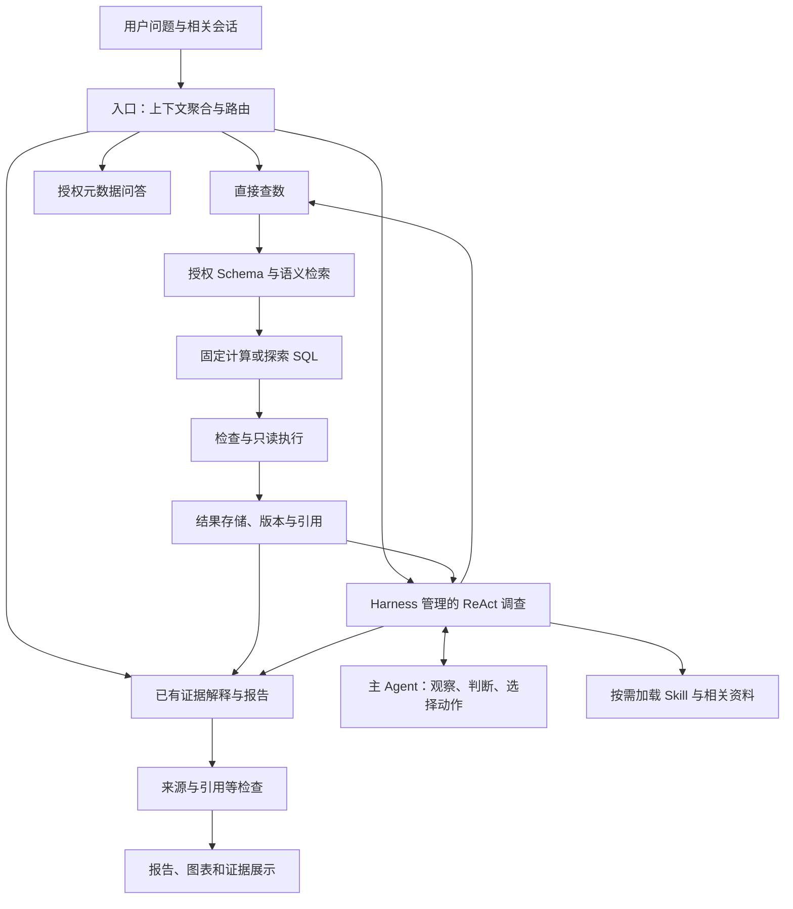

# InsightPilot · 电商经营分析 Agent

**从发现指标异常，到沿着证据找到下一步。**

InsightPilot 面向跨境电商运营，将自然语言查数、动态下钻、证据管理和报告生成组织成连续的分析过程。用户提出经营问题，Agent 选择调查方向，Harness 管理执行、上下文与预算，最终把分散的查询结果整理成可追溯的分析。

## 为什么做这个项目

在电商实习中，我接触到公司已经落地的 Text2SQL 工具。它降低了发起查询的门槛，但实际使用中仍然存在查数不准、单次查询难以承接后续分析的问题。

**更大的工作量往往发生在拿到数字之后。**

下面是根据这些痛点构造的典型工作场景：

> 月度复盘前，运营发现店铺 GMV 下滑，但看板上的整体流量没有明显变化。
>
> 第一轮查数确认了销售额下降，却没有回答该采取什么行动。运营接着需要检查订单量和转化，再拆到渠道、品类和商品；如果发现某个商品变体下降，还要判断是整体需求变弱、库存影响，还是购买转向了其他变体。
>
> 每查出一组结果，都可能出现一个新问题。运营需要不断调整查询、确认指标口径、记录已经排除的解释，再把多个结果拼成复盘报告。

这段流程暴露了三个产品问题：

| 工作中的阻力 | 产品需要提供的帮助 |
|---|---|
| 用户知道业务问题，却不熟悉数据表、关联关系和统计口径 | 将业务表达转成带有明确范围和定义的查询 |
| 一次取数只解决一个局部问题，下一步依赖刚查到的结果 | 根据证据动态决定继续查什么、从哪个维度下钻 |
| 查询结果分散，判断会不断变化，复盘需要重新整理 | 保存结果与判断的关系，把发现、反证和未决项组织成报告 |

因此，项目把目标定为：**让运营围绕一个经营问题持续分析，把更多精力用于判断和行动。** 首批用户是跨境电商运营和业务人员，分析产物服务于异常排查和经营复盘。

## 用户如何使用

| 用户提出的问题 | 系统如何响应 | 设计价值 |
|---|---|---|
| “七月 GMV 是多少？” | 直接查询适用指标 | 简单问题使用简短路径 |
| “七月 GMV 为什么下降？” | 核实变化，再按证据逐步下钻 | 支持分析路径不确定的任务 |
| “那按品类呢？” | 结合前文承接指标、期间和范围 | 减少重复描述条件 |
| “把刚才的结果整理成报告” | 读取保存的实际证据组织报告 | 让取数成果可以继续使用 |
| “现在有几张表？” | 读取授权目录，由 Agent 按问题回答 | 帮助用户了解可用数据 |

报告围绕四件事展开：**发生了什么、证据支持什么解释、还存在哪些不确定性、下一步值得做什么。** 用户可以继续追问、补充背景或核对来源。

## 核心设计与亮点

### 1. 意图路由与上下文聚合，让不同任务走适合的路径

入口将当前问题与近期会话、任务和结果目录结合，在一次模型调用中完成上下文理解、意图判断、相关结果选择与检索需求提取。普通问答、授权元数据查询、直接查数、已有结果分析与复杂调查分别进入适合的处理路径。

例如“那按品类呢”需要承接指标和期间，“根据刚才的结果生成报告”需要找到可复用证据。路由层支持独立配置模型，使入口识别和复杂调查能够采用不同的资源配置。它的价值是减少用户重复解释，避免简单问题承担完整调查的步骤，也让结果追问更自然。

### 2. 以 ReAct 与隐式规划支持动态调查，让下一步由证据决定

项目早期采用 Plan-and-Solve，提前组织任务计划。实践中发现，经营异常调查往往需要在看到初步数据后才能确定有效路径：确认订单量下降，只完成了指标拆解，还需要继续解释订单量的变化。

复杂调查因此调整为 ReAct：

> 观察当前证据 → 选择动作 → 执行取证 → 更新判断 → 决定继续、转向、询问或收尾。

这里的“隐式规划”是指规划融入每轮决策：主 Agent 根据目标、当前证据和未解决问题选择下一步，而不维护一份必须逐项执行的完整预设计划。系统记录动作目的和进度变化，供用户理解与开发者追踪。

这样设计的价值是让调查能够沿异常集中的方向深入，也能在原假设缺乏支持时调整方向。简单查数和明确的计算仍使用更直接的路径，让不同复杂度的任务匹配适合的处理方式。

### 3. 用 Skill 提供业务方法，给自主探索以方向

业务 Skill 提供指标关系、拆解思路、计算注意事项和结论边界。例如先区分订单数与商品件数，分析转化率时检查分子和分母，解释变化时考虑商品结构与竞争解释。

Skill 按需加载，主 Agent 结合当前证据选择方法。这使业务经验可以被维护和复用，同时保留调整调查路线的空间。新增分析方法也可以通过更新对应 Skill 逐步引入。

### 4. 结构化任务状态，让调查始终围绕原问题

系统持续维护用户目标、已做检查、当前事实、待验证假设和未解决问题。判断通过稳定 ID 更新，被撤回或替代的内容进入历史，后续决策读取当前有效状态。

这一设计让长任务有清晰的进展依据：已经查过什么、哪些解释被削弱、还缺哪项证据。与问题相关的正常结果也会保留，为排除错误解释提供依据，并减少重复调查。

### 5. 按角色与阶段组装上下文，兼顾输入效率与证据完整性

运行测试中，部分任务累计输入达到输出的二十多倍。进一步检查实际请求，发现重复任务信息、Schema、指标定义与历史结果等内容，于是将上下文分配纳入代码管理。

| 角色 | 获得的主要信息 | 对任务的帮助 |
|---|---|---|
| 路由 Agent | 当前问题、近期轻量上下文、任务与结果目录 | 识别追问关系，选择合适路径 |
| 主 Agent | 目标、有效判断、检查目录、结果摘要与必要数据 | 集中判断下一步调查方向 |
| 查数模块 | 当前查询相关口径、字段、依赖与诊断 | 聚焦当前计算和失败修复 |
| 报告 Agent | 实际相关证据、当前判断、正常检查与反证 | 支持数字准确呈现和解释边界表达 |

提示词、任务状态、Skill 和结果分开管理，由代码按需选择与组装。完整结果保存在外部，模型可以按引用读取；压缩输入时仍保留范围、单位、完整性和未核对项。

**离线对比结果：两份历史任务的主 Agent 输入组装字符数分别减少 46.8% 和 53.0%。** 比较采用同一任务状态，保留结果与检查目录；这是字符数对比，非实际 token 费用降幅。

### 6. 查数模块的 Schema RAG 与 Rerank，连接业务表达和数据结构

查数检索面向字段和业务语义资料。索引组织字段含义、业务别名、所属表、样例及关联信息，帮助模型找到当前问题需要的数据结构。

检索采用分阶段流程：

1. **BM25 关键词召回：** 匹配字段名、业务术语和明确实体等线索。
2. **Embedding 向量召回：** 补充自然语言表达与字段描述之间的语义关联。
3. **RRF 排名融合：** 合并两路候选，兼顾字面匹配与语义匹配。
4. **Rerank 重排与筛选：** 结合原问题重新评估候选相关性，按阈值和字段数量上限选择输入。

召回范围受数据访问权限约束。检索后的字段与相关语义共同参与查询资料组装，使 SQL 模块能够围绕当前任务获得信息。该设计同时服务于业务词汇映射和上下文控制；重排分数表示相关性，指标含义仍需结合定义与查询检查确定。

### 7. 固定计算与探索 SQL 配合，让标准口径可复用、新问题可探索

对已覆盖的标准指标，程序根据登记定义和适用范围构造查询。当前包括有限范围的支付商品 GMV、订单数、件数及派生指标，也有会话和库存时长相关计算。

新维度、明细或机制调查则保留模型生成 SQL 的能力。两条路径共用权限、检查、结果和预算体系，避免相同指标在不同调查分支中随意改变口径。

这种分工把确定的计算沉淀为可复用能力，把模型的灵活性用于提出和实现新的取证需求。固定计算有明确的数据源、版本、维度和筛选边界，未覆盖的请求不会被强行套入模板。

### 8. 把澄清与技术修复分开，降低用户参与的负担

遇到关键业务条件、指标含义或实体身份不明确时，系统可以通过卡片提问；入口必要条件先确认，调查中的可选背景支持跳过，跳过仍保留为未知。

缺字段上下文、关联映射或 SQL 错误则由系统先定位处理。修复调用只携带失败项和相关诊断，保留同批已经成功的结果。这让用户参与业务判断，同时减少技术错误带来的无效往返。

### 9. 可信交付：既展示发现，也交代查过什么

可信性既来自数字的来源，也来自分析覆盖范围的透明。系统保存完整检查目录，区分异常、正常、失败和未知，并在报告中呈现与问题有关的正常检查及反证。

例如调查 GMV 下降时，如果同口径下的全店会话量没有明显下降，这条正常结果仍值得展示：它说明系统检查过总体流量，并削弱“总体流量下降”这一解释；还需要继续检查流量结构与转化，不能直接推导出唯一原因。

| 向用户展示什么 | 为什么有价值 |
|---|---|
| 检查了哪些指标和范围 | 用户可以判断调查覆盖了哪些方向 |
| 哪些异常、哪些没有异常 | 同时呈现支持和削弱解释的证据 |
| 哪些查询失败、哪些问题仍未知 | 避免把“没查到”误读为“没有问题” |
| 结论对应的结果、版本和统计口径 | 支持核查数字，定位结论依据 |
| 事实、候选解释与未决项的区别 | 帮助用户判断结论可以用于什么决策 |

完整结果保存在证据存储中，界面提供检查目录，报告选择与用户问题相关的证据展开。这种分层兼顾可读性与可核查性，让用户既能看到结论，也能判断分析是否遗漏重要方向。可追溯提高了检查结论的能力，并不自动保证结论正确。

### 10. 前端工作台：把长任务变成可参与、可检查的分析过程

工作台围绕会话、业务进展、结果和技术详情组织页面：主对话呈现问题、发现与报告；按阶段展开调查目的、结果和遇到的问题；任务控制台提供查询结果、运行追踪和输出查看。

用户无需始终阅读技术日志，就能了解当前进展；需要核查时，可以切换结果表并展开详情。澄清卡片包含问题、原因和回答操作，可选背景支持跳过，帮助用户在确实需要业务判断时参与。

界面区分工具执行、调查结束和报告交付，避免把“工具成功”当成“问题已解决”。这些交互围绕等待、补充背景、核对证据和继续追问设计，让前端成为分析过程的一部分。

### 11. 模块、方法与结果复用，让一次分析为后续任务积累价值

项目将复用分为三个层次：

- **模块复用：** 普通查数和经营调查共用 SQL 模块及执行检查；已有结果解释和调查报告复用 DataQA 的报告能力，减少不同入口之间的行为差异。
- **方法复用：** Skill 沉淀分析方法，登记指标沉淀固定计算。二者分别承载调查思路与计算规则，便于针对业务变化维护。
- **结果复用：** 保存带有范围、版本和权限绑定的证据，追问时检查适用性后复用。报告整理与新增取证分开，让已有成果能继续形成报告，不重置旧调查预算。

模块边界也为接入其他经营场景提供了适配位置。迁移时需要替换或扩展业务语义、Skill、计算覆盖与验收题，已有数据源的口径不会自动适用于新业务。

### 12. 为探索设置预算与恢复机制，让执行过程可观察、可控制

Harness 管理最多 8 轮取证、每条逻辑 SQL 总共 3 次生成、20 次工具调用，以及 480 秒主动处理时间，其中调查上限 420 秒。

预算用于限制无效循环；失败分类帮助区分补资料、修查询、改取证方向和询问用户。独立分支失败时保留其他成果，有依赖的判断则明确缺口。运行日志记录模型输入输出、工具执行与阶段状态，为后续优化提供可检查的依据。

## 系统如何协作



这些节点表示职责分工。入口理解请求，主 Agent 决定调查方向，查数模块负责执行，报告模块组织证据；Harness 串联各环节，并管理状态和执行边界。

## 如何衡量与改进

验证分别关注程序行为、实际计算和任务交付：离线回归检查上下文、预算、引用及恢复；真实工具执行与独立核算核对数字；自然业务问题用于检查调查路径、解释与追问。

项目保留正常项、反证和失败记录，评测答案与运行时知识隔离。优化同时看答案质量、问题覆盖、交付情况和成本，不只看 SQL 是否成功或报告是否生成。

2026-11-03 的仓库打包验证通过前端独立安装、生产构建及 76 项相关后端离线测试。后续重点围绕任务完成标准、报告局部修复和按问题影响范围划分的审核策略展开。

## 项目说明

- 当前为使用 HomeNova 模拟电商数据的产品原型，分析建议由用户判断后执行。变体转量用于说明探索性需求，不列为已验收功能。
- 独立报告内容审核当前默认关闭（`REPORT_CONTENT_REVIEW_ENABLED=false`），保留未审核标识及权限、来源、引用等检查。
- 基于已有 AskData 工程并使用 AI 辅助开发，项目工作聚焦需求定义、Agent 执行范式、Harness、上下文与验收设计。
- 当前前端为 `apps/insightpilot`（React / Next.js），后端为 `references/askdata_studio/backend`（FastAPI / LangGraph）。旧 Vue 前端保留用于历史兼容。

## 安装

需要 Python 3.11 和 Node.js 22 或以上。以下命令从仓库根目录运行：

```bash
python3.11 -m venv references/askdata_studio/backend/.venv
references/askdata_studio/backend/.venv/bin/python -m pip install -r references/askdata_studio/backend/requirements.txt
cp references/askdata_studio/backend/.env.example references/askdata_studio/backend/.env
npm ci
npm run build
```

在后端 `.env` 中配置自己的模型服务。配置项见 `.env.example` 和 `backend/app/config.py`，不要提交密钥。公开 HomeNova 演示快照与语义定义已包含；会话数据库、模型调用记录、缓存、私有题库和参考答案不包含在仓库中。

## 启动

分别打开两个终端：

```bash
# 终端一
cd references/askdata_studio/backend
.venv/bin/python -m uvicorn app.main:app --host 127.0.0.1 --port 8001
```

```bash
# 终端二，从仓库根目录运行
npm start
# 开发模式可使用 npm run dev
```

工作台：http://127.0.0.1:5174/data-tasks 。API 文档：http://127.0.0.1:8001/docs 。登录账号与权限说明见 [后端应用说明](references/askdata_studio/README.md)。

开发机服务管理脚本 `scripts/homenova_phase_e/start.py` 及桌面启动器保留原配置，其中含开发机 Node 和共享配置路径；其他机器优先使用上面的直接启动命令。首次检索构建索引可能调用 Embedding 服务并产生费用。

## 验证

```bash
cd references/askdata_studio/backend
PYTHONPATH=.:tests .venv/bin/python -m unittest tests.test_agent_owned_delivery tests.test_multiturn_evidence tests.test_investigation_report -v
```

```bash
# 从仓库根目录运行
npm run build
npm run test:web
```

完整回归与真实场景验收的已知限制记录在检查点中。本次仓库更新没有重新运行真实模型调查或重建数据库。

## 目录与来源

- `apps/insightpilot/`：当前工作台。
- `packages/contracts/`：工作台使用的共享类型。
- `references/askdata_studio/`：后端、测试、旧前端及基础演示数据。
- `data/homenova_phase_d/public/`、`data/homenova_phase_e/public_semantics/`：授权演示快照及语义。
- `scripts/homenova_phase_e/`、`scripts/homenova_harness_v1/`：启动、开发和验证脚本。
- `docs/`：设计记录及实施状态。历史文档中的本机私有日志链接不会随仓库发布。

InsightPilot 前端及共享类型基于 DataFoundry，保留其 Apache-2.0 许可；来源记录见 `apps/insightpilot/datafoundry-source-manifest.json`。本仓库保持独立历史，未导入完整 DataFoundry 项目。`SOURCE_SNAPSHOT.json` 记录初始源码同步范围及当时的源文件哈希，后续文档更新以 Git 历史为准。
