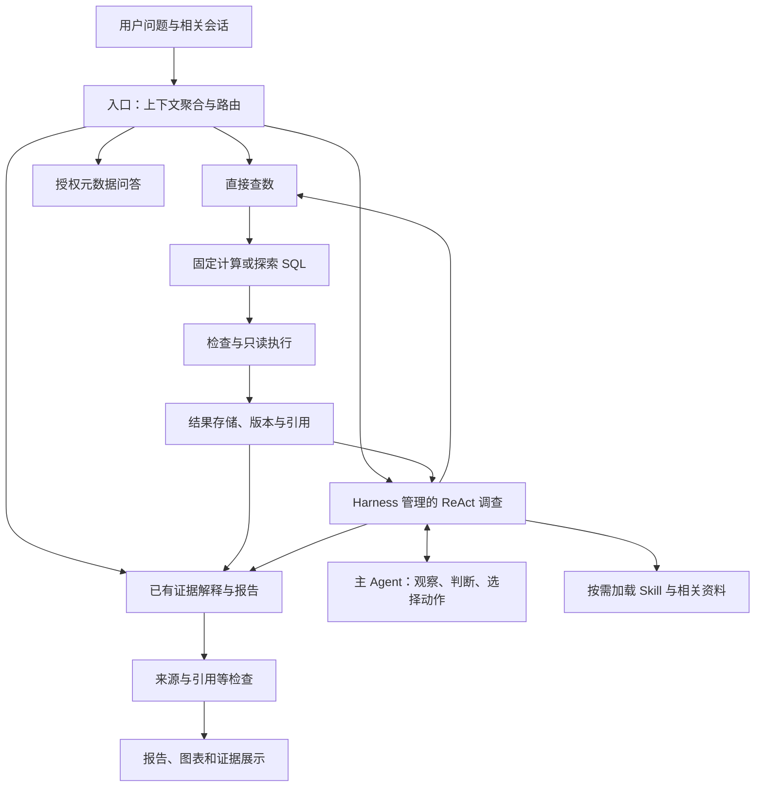

# InsightPilot · 电商经营分析 Agent

从自然语言查数，到根据证据逐步下钻的经营分析。

InsightPilot 是面向跨境电商运营的 Agent 原型，基于已有 AskData 工程演进。它尝试帮助业务人员围绕经营异常完成取数、下钻、核实解释和报告整理，而不只是得到一次 SQL 查询结果。HomeNova 是项目使用的模拟电商业务场景。

**当前阶段：可运行原型，持续验证中。** 使用模拟业务数据，部分计算经过独立核对；尚未证明完整经营分析能够稳定通过验收，也没有真实企业上线或提效收益数据。独立报告内容审核目前暂停，报告明确标识未审核，来源与引用等检查仍保留。

[完整项目案例与 Harness 设计](docs/homenova_project_overview_and_harness_design.md) · [当前实现与验收状态](docs/homenova_protocol_overhaul_checkpoint.md) · [安装运行](#安装)

## 需求来源：已有 Text2SQL，为什么还需要分析 Agent？

在电商实习中，我接触到公司已落地的 Text2SQL 工具，但观察到查询结果不够准确，而且缺少基于结果继续下钻的能力。运营发现指标异常后，仍需要自行组织后续查询、核对口径，再将分散的数据拼成解释。

例如，用户问：

> “七月份 GMV 为什么比六月份少这么多？我感觉销量还可以。”

查出两个月的 GMV 只能确认变化。要回答经营问题，还需要判断下降集中在哪些品类、商品或渠道，核实可能解释，并说明下一步值得检查什么。

非常见问题更需要探索，例如“不同商品变体之间是否发生了转量”。查询路径往往要看到初步结果才能确定，不能提前穷举为固定步骤。变体转量是本项目的需求动机与候选验证场景，目前不作为已验收能力宣传。

由此形成产品假设：**让用户提出业务问题，由 Agent 根据证据逐步调查，减少反复组织取数和手工整理结果的工作。** 这些痛点来自个人实习观察，尚未通过系统用户研究量化其频率与收益。

## 目标用户与任务

第一批用户是需要解释经营异常的跨境电商运营与业务人员。目标是帮助他们形成有证据的阶段性判断和下一步排查动作，暂不自动执行调价、投放或补货。

| 用户需求 | 处理方式 |
|---|---|
| “七月 GMV 是多少？” | 直接查数，无需完整调查 |
| “七月 GMV 为什么下降？” | 根据结果动态选择下钻方向 |
| “那按品类呢？” | 聚合相关前文，判断复用结果还是新增查询 |
| “根据刚才的结果生成报告” | 使用已有证据整理报告，不重新调查 |
| “数据源有几张表？” | 读取授权元数据，由 Agent 按问题回答 |

目标使用故事是：运营在月度复盘前发现异常，提出问题；系统检查核心指标并逐步下钻；运营补充背景或追问；最终获得关键数字、支持与反驳证据、解释边界和下一步建议。这是设计目标，尚不是已验证的客户成功案例。

## 方案演进：从提前制定计划，到依据证据调整路径

早期尝试 **Plan-and-Solve**，由 Planner 制定计划，再交给执行模块完成。对于步骤较确定的任务，这种方式便于组织执行。

在探索性调查中，我发现过早制定具体路径容易锁定某个解释。例如先假设订单量下降，查到订单量确实下降后，就可能把“执行完计划”当作“回答完问题”。订单量是有效的 GMV 分解项，但未必解释订单量为什么下降，也不排除其他因素。

因此，复杂调查调整为 **ReAct**：

> 观察当前证据 → 选择下一步动作 → 执行取证 → 更新判断 → 继续、转向、询问或收尾。

选择理由是任务需要频繁根据新结果调整方向，不是认为 Plan-and-Solve 无法重规划，也不是已经证明 ReAct 在所有任务上更好。

ReAct 更灵活，也可能发散和重复。项目通过 Skill 提供分析方法，通过任务状态维护目标、事实、假设与未决项，再用预算和停止机制控制探索成本。

## Harness：让自主调查在可控的执行环境中进行

Harness 是模型外部的运行控制层，负责组织输入、调度工具、维护状态、保存证据和处理失败。模型选择业务方向，程序管理权限、引用、执行和资源边界。



当前独立报告内容审核暂停，未画入默认执行路径。图中是职责划分，不代表每个节点都是独立长期对话的 Agent。

| 设计 | 解决的问题 |
|---|---|
| 按需 Skill | 提供指标关系、分析方向和结论边界，不预设异常必然对应某个原因 |
| 结构化任务状态 | 维护原始问题、当前判断、检查记录及未决项，避免重复与偏题 |
| 证据引用与版本 | 保存实际查询结果，区分当前有效证据与历史记录 |
| 分类恢复 | 缺资料先补资料，SQL 错误定向修复，业务歧义才询问用户 |
| 预算与收尾 | 最多 8 轮取证、每条 SQL 总生成 3 次、20 次工具调用；主动处理 480 秒，其中调查 420 秒 |

轮次耗尽是停止新增取证的条件，不是“原因已查明”的证明。独立分支失败应保留其他结果，存在真实依赖的后续判断则不能凭空继续。

### 上下文管理：让各角色获得当前需要的信息

运行测试中，部分任务累计输入达到输出的二十多倍。我把它作为排查信号，检查实际模型请求后，发现任务头、条件、Schema、指标定义和历史结果等存在重复。比例本身不能证明浪费，报告反复修订也会放大输入消耗。

改进分为两层：入口聚合相关会话，理解当前问题；执行阶段按角色和任务阶段动态组装上下文。

| 角色 | 主要获得的信息 |
|---|---|
| 路由 Agent | 当前问题、近期轻量上下文、可用任务与结果目录 |
| 主 Agent | 目标、有效判断、检查目录、结果摘要与引用，以及必要数据 |
| 查数模块 | 当前查询的口径、相关字段、依赖结果和技术诊断 |
| 报告 Agent | 实际相关证据、当前判断、正常检查、反证与限制 |

完整结果保存在模型上下文之外，支持按需读取。旧判断通过稳定 ID 更新，撤回和替代记录保留为历史；与问题有关的正常结果和反证不会因为“没有异常”而删除。

提示词、任务状态、Skill 和证据分开管理，由代码选择和组装。减少输入依赖去重和相关性选择，而不是简单把一份 Prompt 拆成多条消息。

### 查数可靠性：确定的计算复用，新的问题保留探索

- **必要澄清：** 不明确的业务条件、指标定义或实体身份可以触发询问。字段映射与资料缺口先由系统处理。
- **业务语义：** 提供指标口径、统计集合、时间、单位、表关系和必要筛选条件。
- **固定计算：** 对覆盖范围内的标准指标请求，由程序构造查询，减少重复生成。当前有有限范围的 GMV、支付订单数、件数及相关计算，以及会话、库存时长路径。
- **探索 SQL：** 未覆盖的新问题仍可由模型生成查询，再经过检查与执行。存在统计集合冲突时不能静默修改条件以求成功。
- **独立核对：** 将具体查询结果与独立计算对照；SQL 执行成功、结构检查通过都不等于业务含义已被证明正确。

这些是准确性保障机制，不是对所有查询准确率的承诺。

## 从运行失败中迭代

| 发现的问题 | 调整 | 证据与限制 |
|---|---|---|
| 上下文重复、输入偏大 | 按角色组装精简视图，保留完整外部证据 | 两份历史任务的主 Agent 输入字符数离线减少 46.8%／53.0%；不是实际 token 费用下降比例 |
| 调查已取得结果，“生成报告”却立即结束 | 将报告整理与新增调查区分，复用原证据，保留旧调查预算 | 相关离线流程通过，最新真实报告质量仍待验收 |
| 审核发现内容问题，但修订循环阻塞交付 | 当前暂停独立内容审核，保留未审核标识与来源检查 | 阶段性取舍；尚未解决内容可靠性，后续需按错误影响范围设计审核 |
| 问“几张表”却收到完整字段清单 | 授权元数据由工具读取，Agent 根据用户问题组织回答 | 相关离线回归通过，避免固定输出替代 Agent 理解 |

详细记录见 [上下文与交付改进](docs/homenova_context_delivery_improvement_20261103.md) 和 [报告续作与审核状态](docs/homenova_agent_restore_review_pause_20261103.md)。

## 验证方式与当前限制

项目区分三层验证：离线回归验证程序行为；真实工具与独立核数验证具体计算；自然业务问题验证调查、报告与追问的完整过程。评测答案和私有核算材料不进入 Agent 运行时知识。

当前能确认的是已实现连续调查、有限固定计算、证据复用与按需上下文，历史运行展示过品类／SKU 下钻。不能据此声称完整归因稳定可靠，也没有同条件对照实验证明 ReAct 优于原方案。

2026-11-03 仓库打包验证通过前端独立安装、生产构建和 76 项相关后端离线测试；测试通过不等于真实报告质量通过。本次描述更新仅修改文档，没有新增模型调查。

下一步重点是：明确任务的阶段性交付标准、验证最新报告链路、设计按影响范围处理的审核策略，并用有限样本和真实用户任务评估质量、成本与可用性。当前不承诺已实现变体转量识别、通用风控或自动经营操作。

## 项目贡献与工程基础

本项目的产品探索围绕需求定义、范式选择、Harness 设计、上下文管理、失败恢复与验收展开。实现基于已有 AskData 工程，并使用 AI 辅助开发；不将所有底层代码表述为独立从零原创。

当前工作台为 `apps/insightpilot`（React / Next.js），后端为 `references/askdata_studio/backend`（FastAPI / LangGraph）。旧 Vue 前端保留用于历史兼容。完整设计、面试讲述和待验证事项见 [项目案例](docs/homenova_project_overview_and_harness_design.md)。

## 安装

需要 Python 3.11 和 Node.js 22 或以上。以下命令从仓库根目录运行：

```bash
python3.11 -m venv references/askdata_studio/backend/.venv
references/askdata_studio/backend/.venv/bin/python -m pip install -r references/askdata_studio/backend/requirements.txt
cp references/askdata_studio/backend/.env.example references/askdata_studio/backend/.env
npm ci
npm run build
```

在后端 `.env` 中配置自己的模型服务。配置项见 `.env.example` 和 `backend/app/config.py`，不要提交密钥。公开 HomeNova 演示快照与语义定义已包含；会话数据库、模型调用记录、缓存、私有题库和参考答案不包含在仓库中。

## 启动

分别打开两个终端：

```bash
# 终端一
cd references/askdata_studio/backend
.venv/bin/python -m uvicorn app.main:app --host 127.0.0.1 --port 8001
```

```bash
# 终端二，从仓库根目录运行
npm start
# 开发模式可使用 npm run dev
```

工作台：http://127.0.0.1:5174/data-tasks 。API 文档：http://127.0.0.1:8001/docs 。登录账号与权限说明见 [后端应用说明](references/askdata_studio/README.md)。

开发机服务管理脚本 `scripts/homenova_phase_e/start.py` 及桌面启动器保留原配置，其中含开发机 Node 和共享配置路径；其他机器优先使用上面的直接启动命令。首次检索构建索引可能调用 Embedding 服务并产生费用。

## 验证

```bash
cd references/askdata_studio/backend
PYTHONPATH=.:tests .venv/bin/python -m unittest tests.test_agent_owned_delivery tests.test_multiturn_evidence tests.test_investigation_report -v
```

```bash
# 从仓库根目录运行
npm run build
npm run test:web
```

完整回归与真实场景验收的已知限制记录在检查点中。本次仓库更新没有重新运行真实模型调查或重建数据库。

## 目录与来源

- `apps/insightpilot/`：当前工作台。
- `packages/contracts/`：工作台使用的共享类型。
- `references/askdata_studio/`：后端、测试、旧前端及基础演示数据。
- `data/homenova_phase_d/public/`、`data/homenova_phase_e/public_semantics/`：授权演示快照及语义。
- `scripts/homenova_phase_e/`、`scripts/homenova_harness_v1/`：启动、开发和验证脚本。
- `docs/`：设计记录及实施状态。历史文档中的本机私有日志链接不会随仓库发布。

InsightPilot 前端及共享类型基于 DataFoundry，保留其 Apache-2.0 许可；来源记录见 `apps/insightpilot/datafoundry-source-manifest.json`。本仓库保持独立历史，未导入完整 DataFoundry 项目。`SOURCE_SNAPSHOT.json` 记录初始源码同步范围及当时的源文件哈希，后续文档更新以 Git 历史为准。
