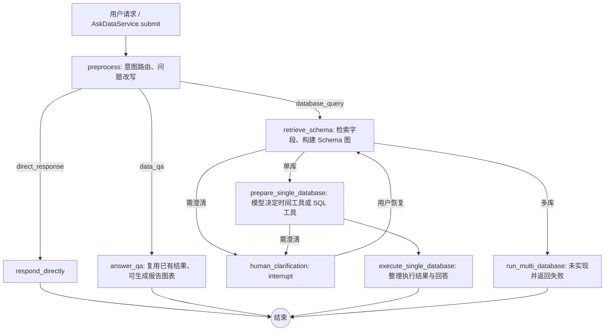

# AskData 电商经营诊断 Agent 底座审计

审计日期：2026-10-25。范围：本项目 `references/askdata_studio`（下称**通用版**）和 `references/askdata_studio_ops_release`（下称**运营场景版**）。两份目录对应用户下载列表中的两个文件夹；**没有证据证明它们分别等于截图所列的 v2.1.0、v2.1.1 压缩包**。因此，本文只用目录名标识版本，不把截图中的版本介绍当作已实现能力。原始审计阶段未修改核心代码；随后用户另行要求修复通用版模型与 SQL 链路，结果见第 7 节。未迁移数据。

证据口径：**[实测]** 表示调用正在运行的本地 API；**[故障注入]** 表示隔离进程使用原项目服务、MCP、DuckDB 代码并替换模型响应或连接；**[代码]** 表示源码可确认；**[数据核算]** 表示绕过 Agent 直接核算本地 DuckDB/CSV；**[推断]** 表示据此提出的产品判断。API 返回的 `steps` 是预设摘要，`execution_log`/`tool_calls` 记录工具层信息，**不是逐节点的完整 LangGraph 事件流**。

## 结论

**建议以通用版为电商底座，选择性吸收运营场景版的 SQL 校验、有限重试和评测脚本。** 两者现有图结构基本相同，都只具备“意图路由 → Schema 检索 → 一次数据库查询 → 回答”的固定流程；均没有结构化 Planner，也没有读到中间业务结果后选择下一调查方向的闭环。运营版的“运营”是短视频播放业务，不能自动迁移成电商经营诊断能力；通用版已有电商 GMV、商品、店铺等表，但它目前也不能完成“为什么下降”的诊断。[代码][实测]

按照本任务的 A/B/C 定义，**两个版本都属于 A：固定工作流中由模型生成 SQL**；SQL 文本不是开发者预先写死的，但节点顺序和查询后终止是预设的。运营版的执行错误重试是 A 内的局部修复，尚不足以构成 B，更不是 C。[代码][故障注入]

## 1. 两个版本的实际架构与入口

两版的服务入口均为 [`backend/app/services/askdata_service.py`](../references/askdata_studio/backend/app/services/askdata_service.py#L20) / [运营版同名文件](../references/askdata_studio_ops_release/backend/app/services/askdata_service.py#L20)：`AskDataService.submit()` 解析用户权限与会话、生成 `task_id`，再调用 `QueryWorkflow.invoke()`。图入口是 [`query_graph.py:66`](../references/askdata_studio/backend/app/workflows/query_graph.py#L66) / [运营版图](../references/askdata_studio_ops_release/backend/app/workflows/query_graph.py#L66)；`task_id` 被用作 LangGraph 的 `thread_id`，会话历史另由 `SessionContext` 组织。[代码]

上图两版适用。条件边明确写在 [`_compile()`](../references/askdata_studio/backend/app/workflows/query_graph.py#L66)：`preprocess` 依据 `intent.action` 分三路；`retrieve_schema` 依据 `database_names` 与澄清状态分流；`prepare_single_database` 仅依据有无澄清分流。`execute_single_database → END`，**没有回到 Planner 或继续调查的边**。多库分支是显式未实现的占位节点，[`_run_multi_database()`](../references/askdata_studio/backend/app/workflows/query_graph.py#L346)。[代码]

状态定义在 [`QueryState`](../references/askdata_studio/backend/app/workflows/state.py#L6) / [运营版](../references/askdata_studio_ops_release/backend/app/workflows/state.py#L6)：有 `session_id`、`workspace`、`short_term_context`、`recent_result_context`、`intent`、`retrieval`、`schema_graph`、`clarification`、`mcp_execution`、`mcp_tool_trace`、`execution_log`、`result`；**没有**计划步骤、待检验假设、证据覆盖、下一行动、调查预算或停止原因字段。[代码]

主要调用关系：[`RequestPreprocessor.prepare()`](../references/askdata_studio/backend/app/preprocessing.py#L52) 做路由和检索词提取 → [`SchemaIndex.retrieve()`](../references/askdata_studio/backend/app/retrieval/service.py#L86) 与 `SchemaGraphBuilder.build()` 提供字段图 → [`SingleDatabaseAgent.prepare()`](../references/askdata_studio/backend/app/querying/single_database_agent.py#L29) 调本地 [`MCP server`](../references/askdata_studio/backend/app/mcp_runtime/server.py#L26) → `DuckDbEngine` 执行只读 SQL → [`ResponseGenerator.finalize()`](../references/askdata_studio/backend/app/querying/response_generator.py#L22) 生成说明。已有结果问答走独立 [`DataQaAgent.run()`](../references/askdata_studio/backend/app/querying/data_qa_agent.py#L36)，可调用柱状图/饼图展示工具，但它没有数据库调查工具。[代码]

两版都使用本地 in-process MCP，当前工具仅为日期、数据库查询、柱状图、饼图等；**没有外部竞品工具**，多库 handoff 也未启用。`InMemorySaver` 作为图检查点，[`SessionContext`](../references/askdata_studio/backend/app/services/session_context.py#L18) 管会话任务；归档默认关闭（[`config.py:64`](../references/askdata_studio/backend/app/config.py#L64)）。这些适合原型，不等于可恢复的持久调查状态。[代码]

## 2. 实际运行测试

测试时通用版前端 `:5174`、API `:8001`，运营版前端 `:5175`、API `:8002` 均返回 HTTP 200；两版登录、Schema API 可用。通用版 Schema API 涵盖电商与 mock 共 55 表，其中电商 50 表；运营版是短视频 41 表。两版各暴露 5 个 MCP 工具。测试使用真实已配置的模型、embedding 和 rerank 服务；没有把“模型未配置”当作解释。[实测] 原始请求、完整 API 响应、SQL、`execution_log` 和错误保存在 [通用版运行记录](askdata_audit_evidence/studio_live.jsonl)、[运营版运行记录](askdata_audit_evidence/ops_live.jsonl)、[通用版有效领域对照](askdata_audit_evidence/studio_control.jsonl)、[运营版有效领域对照](askdata_audit_evidence/ops_control.jsonl)。

### 2.1 用户指定的六类测试

| 输入 / 检查 | 通用版真实输出与轨迹 | 运营场景版真实输出与轨迹 |
|---|---|---|
| `哪个品类的 GMV 下降最多？` | `waiting_clarification`，询问对比期；选择建议项“本月 vs 上月”后，先调 `resolve_date_range`，再调 `query_ecommerce_ops` 执行 `DESCRIBE daily_product_metrics`，被只读守卫拒绝：`只允许执行SELECT/WITH只读查询`，无结果。[实测] | `failed`；检索命中 0，但模型仍在短视频表 `content_daily_metrics` 生成不存在的 `cdm.gmv`。`query_short_video_ops` 连续失败 3 次，最终 `Binder Error ... cdm.gmv`；无 GMV 数据。[实测] |
| 同会话追问 `为什么？` | `direct_response`，猜测“上一轮 SQL 可能包含非只读操作”；**没有新工具调用，也没有原因分析**。实际上被拒的是 `DESCRIBE`，不是数据修改。[实测] | `direct_response`，解释缺少 `gmv` 列；无新工具调用。[实测] |
| 继续 `把刚才的结果画成图` | 因前题无数据，直接说明无法画图；无工具调用。[实测] | 同样说明无数据；无工具调用。[实测] |
| 同会话改问 `当前数据库有哪些表？` | `direct_response`，拒绝直接列出表清单；无 Schema/DB 工具调用。这是上下文切换后的路由行为，**不是成功回答**。[实测] | 同样拒绝列出表清单；无工具调用。[实测] |
| `最近经营表现不太好，帮我看看怎么回事` | 先澄清；其理由误称 `daily_store_metrics` 无日期字段。选择建议的“店铺日经营指标默认汇总”后，调 `current_datetime` 和**一次** `SELECT ... FROM daily_store_metrics LIMIT 200`，得到 200 行店铺记录，没有时间过滤、基线比较或诊断分支。表实际有 `stat_date`。[实测][数据核算] | `completed/direct_response`，只问时间和指标，无 Schema/DB 工具、无计划、无诊断。[实测] |
| SQL 错误、模型连接中断/超时 | 实际请求的只读守卫错误明确返回 `failed`；复杂 GMV 调查两次实测在模型请求处约 138–139 秒后收到 HTTP 403，无 SQL/结果。隔离故障注入下，错误 SQL 执行一次即结束；模型不可达或超时返回“暂时不可用”，却标为 `completed/direct_response`，`route_fallback.success=true`。[实测][故障注入] | 实际 GMV 请求对错误列重试 3 次仍失败；另一个调查请求先因 `short_video_ops.video_plays` 限定名不存在而失败，再去掉限定名成功。隔离故障注入亦验证错误 SQL 能在第 2 次调用修复；模型不可达/超时同样被标为 `completed/direct_response`。[实测][故障注入] |

模型故障注入的隔离记录见 [通用版故障记录](askdata_audit_evidence/studio_faults.json) 与 [运营版故障记录](askdata_audit_evidence/ops_faults.json)；使用真实项目组件但脚本化模型回应或本地故障端点，不能替代生产链路稳定性测试。通用版 403 的复测见 [调查复测](askdata_audit_evidence/studio_investigation_retry.jsonl)。403 原因无法从现有响应确认，**不归因于配额、鉴权或代码中的某一种**。[实测]

**后续故障定位（同日追加）**：审计完成后，通用版运行日志出现另一条更明确的供应商响应；使用当时同一 `qwen3.7-plus` 配置发送最小“你好”请求，DashScope 返回 HTTP 400，`error.code=Arrearage`。这证明**当时**模型调用被账号结算状态拦截；它不能反推上述两次 HTTP 403 的具体原因。密钥已配置，本地 API 健康检查通过也不代表上游模型可调用。[实测] 阿里云对该错误码的说明见[官方错误码文档](https://help.aliyun.com/zh/model-studio/error-code#overdue-payment)。

**充值后复核（同日再次追加）**：使用两版各自的 `ModelClient.chat()` 发最小请求均成功，说明 `Arrearage` 阻断已经解除。通用版完整 GMV 调查再次运行约 139 秒后仍在 `single_database_agent` 收到 HTTP 403，且未调用数据库；原始响应见[充值后复杂请求记录](askdata_audit_evidence/studio_post_recharge.jsonl)。随后立即发起的短请求被代码的 30 秒熔断拦截；熔断结束后，短请求已能走到 `query_ecommerce_ops`，但模型生成了查询 `information_schema.columns` 的 SQL，被表白名单拒绝，详见[充值后短请求记录](askdata_audit_evidence/studio_post_recharge_short.jsonl)。因此，充值解决了明确的账务错误，**并未解决复杂请求的 403 或现有 SQL 生成缺陷**；403 响应体只有 `Forbidden`，尚不能确定具体上游原因。[实测][代码]

### 2.2 有效领域对照：排除“只是问题不匹配”的干扰

| 对照任务 | 通用版 | 运营场景版 |
|---|---|---|
| 明确查数 | 输入“2026年8月1日至22日，按商品类目统计GMV，列出GMV最高的前5个类目。”；1 次 `query_ecommerce_ops`，SQL 联结 `daily_product_metrics/products/product_categories`，返回 5 行，女装 13,876,611.9 元居首。[实测] | 输入“2026年8月1日至28日，按内容分类统计播放量，列出播放量最高的前5类。”；1 次 `query_short_video_ops`，联结 `content_daily_metrics/contents/content_categories`，返回 5 行，亲子 637 次居首。[实测] |
| 有效结果后追问 `为什么？` | 路由 `data_qa`，指出现有前五名汇总缺订单、流量、转化等证据；**不追加查询**。[实测] | 路由 `data_qa`，指出无法凭前五名解释原因；**不追加查询**。[实测] |
| 有效结果后 `把刚才的结果画成图` | `failed/qa_answer`：`普通回答不能调用前端展示工具`。[实测] | 同一错误。[实测] |
| 改用“生成简短分析报告，并附一张柱状图” | `qa_report` 成功，`report_tool_calls` 含 1 次 `build_bar_chart`，引用上个任务的真实字段；见 [报告记录](askdata_audit_evidence/studio_report.jsonl)。[实测] | 同样成功；见 [报告记录](askdata_audit_evidence/ops_report.jsonl)。报告文字出现未经数据验证的“暑期家庭用户活跃”解释，需作为假设而非事实。[实测] |

这说明**数据复用与图表工具存在，但“直接画图”的意图到输出动作衔接有缺口**。根因可在 [`DataQaAgent._execute()`](../references/askdata_studio/backend/app/querying/data_qa_agent.py#L75) 看到：`action=answer` 时禁止任何 `tool_calls`；模型若为绘图请求同时给出 `answer` 和图表工具就报错。[代码][实测]

## 3. Planner、动态重规划、Reflection 审计

### Planner：没有可执行的调查计划

[`RequestPreprocessor.prepare()`](../references/askdata_studio/backend/app/preprocessing.py#L52) 生成意图路由、独立问题和检索词；[`SingleDatabaseAgent.prepare()`](../references/askdata_studio/backend/app/querying/single_database_agent.py#L29) 生成一次工具选择与 SQL；二者都没有输出可执行步骤列表。`QueryState` 无 `plan` 字段，图中无 Planner 节点，也无计划执行器。[代码] 运营版 `query_contract` 包含模型声明的粒度、表、过滤和指标，但它在单次工具调用的 trace 中，不是跨步计划；其校验主要检查输出 JSON、工具名和显式样例值过滤（[`_validated_decision()`](../references/askdata_studio_ops_release/backend/app/querying/single_database_agent.py#L137)），没有通用的指标口径与联结粒度验证。[代码]

### 动态重规划：“为什么 GMV 下降”逐项核对

**通用版**：明确要求“先核对整体 GMV，再根据结果调查品类、店铺或退款”的真实请求在模型接口 HTTP 403 处终止，**未执行整体查询**；较短的复测也在同一处失败。不能用这两次失败的轨迹判断它是否会追某品类。[实测] 但代码把单库执行节点直接连到 `END`，并且数据库工具一旦返回便停止本次工具循环（[`single_database_agent.py:119`](../references/askdata_studio/backend/app/querying/single_database_agent.py#L119)）。因此，现有工作流**不可能**在同一调查任务中读取第一条成功 SQL 的业务结果，再自行发起第二条方向性 SQL。[代码]

**运营版**：将业务问题换成其真实领域，输入“2026年8月1日至28日相比2026年7月1日至28日，整体播放量为什么下降？请先核对整体变化，再根据实际查询结果决定是否调查内容分类、渠道或曝光因素；如果没有下降，请如实说明。”第一次 `query_short_video_ops` 因不存在的 `short_video_ops` schema 失败；第二次修正为 `FROM video_plays`，返回 7 月 9,060、8 月 21,970，随后回答“未下降”。这里**确实核对了前提并正确停止**，但只有一条成功的业务查询；第二次 SQL 是执行错误修复，不是根据中间业务结果选择新调查维度。[实测] 同期 `content_daily_metrics.play_count` 另有不同合计口径，表明“播放量”的权威事实表未定义清楚；不能仅凭最终答复认定指标已验证。[数据核算]

针对产品要求的“若一个品类实际下跌则追负向贡献；若多个品类都增长但低于目标则追增长缺口”：两版都**没有**目标偏差分支、贡献分解、结果驱动的继续/停止决策。[代码] 现有数据可人工核算：通用版 `daily_product_metrics` 在 2026-07-01～07-22 的 GMV 为 307,206,498.67，08-01～08-22 为 283,582,473.58，下降 23,624,025.09（约 7.69%）；最大负向类目为运动鞋服，减少 7,225,483.74。[数据核算] 这些数值是**独立核算，不是 Agent 的输出**；复核脚本与结果见 [baseline_checks.py](askdata_audit_evidence/baseline_checks.py) 和 [baseline_checks.json](askdata_audit_evidence/baseline_checks.json)。当前目标数据为店铺/月粒度，不能无依据地分摊成类目目标，所以“多个类目低于目标”案例尚缺可审计的类目目标口径。[数据核算]

### Reflection：有薄的结果说明与局部错误重试，无证据反思

两版的 [`ResponseGenerator.finalize()`](../references/askdata_studio/backend/app/querying/response_generator.py#L22) 给模型看问题、SQL、结果前若干行和 Schema，让它返回 `valid/reason/title/analysis`。这可以**尝试判断结果是否答题**，并非只检查 SQL 成败；但 `valid` 默认可落到 `true`，没有独立的指标定义、联结重复计数、总体与分组核对、证据充足度检查，也无 `valid=false` 后的针对性修复边。[代码] `DuckDbEngine` 的只读和权限检查防写入，不能证明业务语义正确。[代码]

运营版 [`SingleDatabaseAgent.prepare()`](../references/askdata_studio_ops_release/backend/app/querying/single_database_agent.py#L76) 在数据库错误时将错误喂回模型，最多受 `max_tool_calls=3` 限制；真实请求和脚本化故障注入都观察到修 SQL。[实测][故障注入] 通用版在首次数据库工具响应后直接返回，脚本化错误 SQL 只执行一次。[代码][故障注入] 两版都没有定位“Schema 检索错、计划错、SQL 错、数据口径错、执行错”各阶段责任的机制；尤其运营版 GMV 检索命中 0 仍生成不存在字段并重复失败，证明重试不等于完整 Reflection。[实测][代码]

## 4. 底座对比

表内标签说明证据来源，`未验证` 表示本轮没有可支持“通过”的实际案例。

| 评估维度 | 通用版 | 运营场景版 |
|---|---|---|
| 部署和运行稳定性 | 前后端/API 可访问，明确电商查数成功；复杂请求两次模型 HTTP 403，不能称端到端稳定。[实测] | 前后端/API 可访问，明确播放量查数成功；GMV 越域请求失败是领域不匹配，另有 SQL 自修成功。[实测] |
| 意图识别与上下文聚合 | 成功将有效结果后的“为什么”路由至 `data_qa`；错误后追问变直接答复，表清单也直接拒绝。[实测] | 类似；模糊经营问题直接澄清但未建任务。[实测] |
| Schema 检索与 SQL 生成 | 电商字段召回及明确 GMV 查询可用；模糊请求错认日期字段，`DESCRIBE` 触发守卫。[实测] | 短视频明确查询可用；GMV 检索 0 命中仍幻觉列。[实测] |
| 多步任务规划 | 无计划节点/状态；单次工具选择。[代码] | 同图，无跨步计划；`query_contract` 只是单次声明。[代码] |
| 根据中间结果动态重规划 | 查询完成即结束；复杂案例被 403 阻塞，实测未验证，但代码可确认无循环。[代码][实测] | 执行错误可重试；业务结果后不继续查询。[代码][实测] |
| 结果校验与错误恢复 | 只读校验、模型 `valid` 说明；DB 失败不重试，模型故障状态标记不准。[代码][故障注入] | 相同结果说明；多了有限 SQL/输出重试，但没有口径和证据验证。[代码][实测] |
| 数据分析和可视化 | 已有结果 QA、显式报告+柱状图成功；直接绘图失败，无新证据分析。[实测] | 同；显式报告可能给出未经证实的解释。[实测] |
| MCP 工具扩展能力 | in-process 工具注册可扩展；现无竞品工具，多库未实现。[代码] | 同；已注册的是短视频查询工具。[代码] |
| 任务状态与记忆管理 | `InMemorySaver`、会话上下文、可选归档；无持久调查计划状态。[代码] | 同。[代码] |
| 改造成电商经营诊断 Agent 的工作量 | 可保留电商 Schema/数据/权限与 UI，需新增调查循环和指标治理；**相对较低**。[代码][推断] | 同样要新增调查循环，还需接入/迁移电商语义层；局部 SQL 重试可移植；**相对较高**。[代码][推断] |

## 5. 最小可行改造方案（本次未实施）

| 类别 | 能力与处理方式 |
|---|---|
| **可直接复用** | 通用版服务/API/UI 骨架、权限范围、Schema 索引和图、只读 DuckDB/MCP 调用、已有结果 QA、图表配置、基础会话入口。复用前需用新数据复测。[代码][实测] |
| **需要修改** | 将路由明确分为简单查数、已有结果分析、需调查的模糊问题；把运营版的输出校验和 SQL 错误有限重试移入通用版；修“直接画图”动作；把模型不可用标为可重试失败；将相对时间与数据最新日期对齐；校验 Schema 命中为 0 时不得编造字段；增强 `ResponseGenerator` 的证据等级。[代码][实测][推断] |
| **需要新增** | 结构化调查状态与 Planner、观察结果后的方向选择和停止判断、指标/目标语义字典、贡献与增长缺口算法、可靠的证据验证 Harness、外部竞品工具准入判断、逐步轨迹与持久检查点、针对性评测集。[推断] |

**推荐继续使用 LangGraph**：当前图已有中断、条件路由和检查点，加入 `plan → execute → validate → observe → decide/stop` 的有限循环即可承载 Harness；换框架不会补上缺失的业务决策。关键是状态和验证器设计，而不是节点名字。[代码][推断]

**MVP 不必保留独立的 Coder 与 Data-Analysis 两个 Agent**。现有源码也未发现以这些名称实现的独立图节点。先用一个调查控制器加受约束的 SQL 执行节点、确定性计算/验证节点及可选报告节点，减少代理之间的上下文和口径漂移。若以后需要生成任意代码或复杂统计，再以有明确输入输出契约的专用能力拆分；不能因为宣传材料提到智能体就预设两 Agent 架构。[代码][推断]

建议的最小状态：`goal`、`metric_definition`、`time_window`、`comparison_window`、`plan_steps`、`observations`、`hypotheses`、`evidence_refs`、`coverage`、`attempts`、`tool_budget`、`stop_reason`。每一步在工具返回后记录结果与口径，再从候选方向中选择**一条最有信息增益且有数据支持**的查询。停止条件：已回答且证据足够、前提不成立、无可用数据、预算耗尽、重复无进展、连续故障。必须让用户看到“事实 / 假设 / 未验证”。[推断]

经营诊断需要两条并行但有区别的量化路径：

1. **实际负向贡献**：统一时间、币种、订单取消/退款口径，在可加总维度下计算 `本期 − 基期`，校验分组之和与总体差额，优先调查显著负贡献。
2. **增长缺口**：当总体或多类目仍增长时，计算 `实际 − 目标` 或 `实际增长 − 目标增长`，单列低于目标的正增长；若只有店铺目标，不得擅自推导类目目标。

外部竞品工具应由明确规则触发，例如内部流量/转化/供给证据不足且问题确有市场外因假设；查询后标注来源与时间。图表应在结果具有合适的维度序列、或用户明确要报告时建议/生成，而非每次强制执行。[推断]

Harness 至少做：只读 SQL 和权限、字段存在、事实表与指标口径、联结基数与重复计数、时间覆盖、分组和总体核对、目标粒度兼容、空值/异常值、引用到每条证据；SQL 错误有限次按错误类型修，业务证据不足时可选择补查，超预算则诚实停止；持久记录每次计划版本、工具输入/输出、错误、决策理由和停止原因。现有 `execution_log` 可作起点，但不够重放完整调查。[推断]

## 6. 成本、主要风险与下一阶段

**粗估**：一名熟悉 Python/LangGraph/SQL 的工程师，做可演示且可审计的本地 MVP 约 **25–40 个工程日（约 5–8 周）**；其中指标与目标口径/数据准备 5–8 日，路由和调查循环 8–12 日，验证/故障恢复/轨迹 7–12 日，评测与 UI 衔接 5–8 日。此为规划估算，不含生产数据集成、安全评审和上线运维。[推断]

主要风险按优先级：

1. **指标口径与数据粒度**：GMV、净收入、订单、退款跨表可能重复，目标与类目不匹配；不先定义权威事实表，Planner 只会更快地产生貌似合理的错误结论。[数据核算][推断]
2. **数据时效**：通用版示例数据截至 2026-08-22，而审计日为 2026-10-25；“最近/本月”默认查询可能空或误导。需明确数据最新日与可比窗口。[数据核算][实测]
3. **模型依赖与状态语义**：通用版复杂请求遇到 HTTP 403，且超时兜底返回 `completed`；会掩盖未完成任务。需分离模型故障和业务结论。[实测][故障注入]
4. **伪因果与停止条件**：只查到相关变化不能断言原因；调查预算、证据分级和“不足以判断”比多查表更关键。[实测][推断]

下一阶段建议先产出一页**电商指标契约**（GMV/退款/目标、事实表粒度、可加总维度、数据最新日），再构造 10–15 个带标准答案与反例的离线案例，包括“实际下降”“增长但未达目标”“多维度同时变化”“外部因素不明”“空数据/模型错误”。随后在通用版的独立改造分支实现最小调查循环，并用同一套案例与当前固定流程对照；这一步才开始修改架构。[推断]

## 证据文件与可复核方式

- [实时探针脚本](askdata_audit_evidence/run_live_probe.py)；[通用版原始运行记录](askdata_audit_evidence/studio_live.jsonl)；[运营版原始运行记录](askdata_audit_evidence/ops_live.jsonl)。
- [有效领域对照脚本](askdata_audit_evidence/run_control_probe.py)；[通用版对照记录](askdata_audit_evidence/studio_control.jsonl)；[运营版对照记录](askdata_audit_evidence/ops_control.jsonl)。
- [报告探针脚本](askdata_audit_evidence/run_report_probe.py)；[通用版报告记录](askdata_audit_evidence/studio_report.jsonl)；[运营版报告记录](askdata_audit_evidence/ops_report.jsonl)。
- [故障探针脚本](askdata_audit_evidence/run_fault_probe.py)；[通用版故障记录](askdata_audit_evidence/studio_faults.json)；[运营版故障记录](askdata_audit_evidence/ops_faults.json)。
- [独立数据核算脚本](askdata_audit_evidence/baseline_checks.py)；[核算结果](askdata_audit_evidence/baseline_checks.json)。
- [充值后复杂请求记录](askdata_audit_evidence/studio_post_recharge.jsonl)；[充值后短请求与熔断记录](askdata_audit_evidence/studio_post_recharge_short.jsonl)。
- [通用版修复后的真实 API 回归记录](askdata_audit_evidence/studio_fix_verification.jsonl)。

每条 JSONL 保留原始 `request` 和 `response.body`，包含 `task_id`、`status`、`route`、`sql`、`rows`、`retrieval`、`execution_log`、`tool_calls` 与报告工具调用。评估结论仅对应此次样本；模型输出非确定性，不把一次成功当作稳定通过，也不把模型 403 当作业务能力失败的唯一证据。

## 7. 后续修复与复测（原始审计之后）

用户充值后，最小模型请求已正常，但通用版复杂 GMV 查询仍在 `single_database_agent` 遇到 HTTP 403。隔离对照中，仅将同一模型请求改为 `enable_thinking=false`，完整 GMV 查询在约 23 秒内完成；原路径约 139 秒失败。此实验支持默认思考模式与长耗时有关，**不能仅凭它断言供应商 403 的内部原因**。[实测]

根据该结果，后续只修改了通用版：[`config.py`](../references/askdata_studio/backend/app/config.py) 和 [`model_client.py`](../references/askdata_studio/backend/app/model_client.py) 默认关闭思考模式（可通过 `LLM_ENABLE_THINKING` 调整），非重试性 HTTP 4xx 不再触发 30 秒熔断；[`SchemaGraphBuilder`](../references/askdata_studio/backend/app/retrieval/graph.py) 在时间问题中补充已选事实表的真实日期字段；[`SingleDatabaseAgent`](../references/askdata_studio/backend/app/querying/single_database_agent.py) 精简重复检索内容，并在数据库错误后有限次修正 SQL；[数据库查询 Skill](../references/askdata_studio/backend/app/skills/database_query/SKILL.md) 明确只用 CSV 视图名和 Schema 图字段；模型不可用兜底现在返回失败状态。[代码]

通用版 API 已重启，前端 `:5174` 和 API `:8001` 均正常。后端 **64 个测试通过**。真实 API 回归：明确的“2026年8月1日至22日类目 GMV 前五”用一条 SQL 返回 5 行，女装 13,876,611.9 元居首，耗时 15.53 秒；“2026年8月1日至22日相比7月同期，整体 GMV 为什么下降”用一条 SQL 返回店铺日表口径的本期 107,191,658.39 元、上期 110,609,730.08 元，下降 3.09%，耗时 18.29 秒；两次均无 HTTP 403。完整输入、SQL、工具轨迹与输出见[回归记录](askdata_audit_evidence/studio_fix_verification.jsonl)。[实测]

**范围边界**：第二条请求虽然恢复了问数，但仍只执行一条业务 SQL，并回复“建议进一步下钻”；它没有自动查询品类、店铺或退款。此修复解决模型链路和常见 SQL 错误恢复，**没有实现原产品目标中的动态多步调查**。另外，通用版 `daily_store_metrics` 与 `daily_product_metrics` 的 GMV 合计不同，后续仍需确定权威指标口径。[实测][数据核算]
